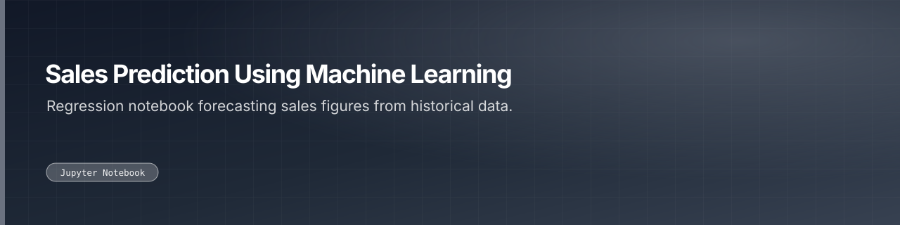

Regression notebook forecasting sales figures from historical data.

 

 

---

## What this is

A sales-forecasting exercise: regression over historical sales data worked through in a single notebook.

|  |
|:--:|
| **1** |
| docs |

---

<a href="https://github.com/gowtham-creator/sales-prediction-using-machine-learning">gowtham-creator/sales-prediction-using-machine-learning</a>

